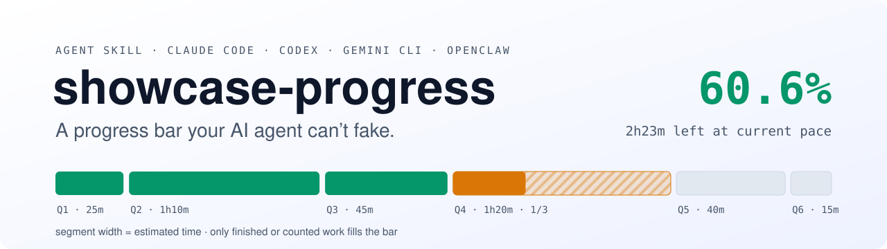

<p align="center">
  <picture>
    <source media="(prefers-color-scheme: dark)" srcset="assets/banner-dark.svg">
    
  </picture>
</p>

<p align="center">
  <a href="https://github.com/panzero666/showcase-progress/actions/workflows/test.yml"></a>
  
  
  <a href="https://agentskills.io"></a>
  <a href="LICENSE"></a>
</p>

<p align="center">
  <b>English</b> · <a href="README.zh-CN.md">中文</a>
  &nbsp;|&nbsp;
  <a href="#install">Install</a> · <a href="#how-it-works">How it works</a> · <a href="PROMPT.md">Prompt-only version</a> · <a href="#faq">FAQ</a>
</p>

---

Your agent says **"about 70% done, almost there."** An hour later it says the same thing.

**showcase-progress** replaces that feeling with a ledger. The agent plans and estimates;
a tiny script does the arithmetic, and only finished or countable work moves the bar.

| What your agent usually says | What showcase-progress shows |
|---|---|
| "About 70% done" | `60.6%`: 166 of 275 planned minutes, straight from the ledger |
| Splits the job into 20 steps, does the easy ones first | Weighted by estimated time, so splitting can't inflate it |
| "Just a few more minutes"… for an hour | **2h23m left at current pace**: the ETA is rescaled by measured speed |
| "Done!" (the file exists, does it run?) | Done needs evidence; `check` flags done-without-proof |
| Starts over after you close the session | The ledger is a file on disk: `render` and carry on |

## See it run

<p align="center"></p>

Watch the right-hand number after **Q2**: time left goes **up**, from 4h10m to 4h16m.
Q1 and Q2 both ran long, so the script stopped trusting the plan and rescaled the rest.
That's the honest answer, even if it's not the one anyone wants to hear.

## How it works

showcase-progress is an [Agent Skill](https://agentskills.io): a `SKILL.md` plus one
dependency-free Python script.

- **Time-weighted.** `progress = estimated time of done subtasks / estimated time of all subtasks`.
- **In progress earns nothing.** The one exception is a real count: `--count 3/6` handlers
  migrated. A count is evidence; a guessed "60%" is not.
- **Self-correcting ETA.** The script times each subtask itself, from `doing` to `done`. After two
  samples covering 20%+ of the plan, if the pace is off by more than 15%, time left is rescaled.
- **Evidence for done.** Subtasks can carry `done_when`; mark them done with `--evidence`.
- **Survives restarts.** `replan` keeps finished work and records why the plan changed.
- **Always visible.** An optional Claude Code [status line](#status-line) keeps the bar on screen.
- **English and Chinese output**, chosen from the task title.

## Built with itself, and it caught us

This repo was built by an AI agent (Claude) tracking its own work with showcase-progress.
The ledger is real; here is what it showed:

| Repo setup, script, tests, docs, live test, README (Q2–Q7) | Time |
|---|---|
| Planned (the agent's estimates) | 3h05m |
| What the agent **reported** with `--took` | 2h20m |
| What the ledger's **clock** says, first update to last | **10m21s** |

The agent wasn't lying on purpose. Asked "how long did that take?", it answered in
human time. That is exactly the kind of made-up number this project exists to stop,
so v1.1 stopped trusting it: **the script now times every subtask itself**, from
`doing` to `done`. `--took` is only an override for numbers you actually have.

## Install

**Claude Code: one command** (Claude Code 2.1.275+)

```text
/plugin install showcase-progress --marketplace panzero666/showcase-progress
```

On older versions: `/plugin marketplace add panzero666/showcase-progress`, then
`/plugin install showcase-progress@showcase-progress`.

**Any agent:** the skill is one folder. Put it where your agent looks for skills.

| Agent | Where | Status |
|---|---|---|
| **Claude Code** | `~/.claude/skills/showcase-progress` (or `.claude/skills/` in a repo) | ✅ tested on a real multi-step task |
| **Codex** (CLI / IDE / app) | `~/.agents/skills/showcase-progress` (or `.agents/skills/` in a repo) | ☑️ layout checked against docs |
| **Gemini CLI** | `~/.agents/skills/` or `~/.gemini/skills/` | ⚪ follows the spec, untested |
| **OpenClaw** | `~/.agents/skills/`, or `openclaw skills install git:panzero666/showcase-progress` | ⚪ follows the spec, untested |
| **Other Agent Skills tools** | their skills folder | ⚪ follows the spec, untested |
| **ChatGPT / DeepSeek / Gemini web / Kimi …** | paste [`PROMPT.md`](PROMPT.md) into custom instructions | 📝 prompt-only, numbers are estimates |

**macOS / Linux**

```bash
git clone https://github.com/panzero666/showcase-progress.git
cd showcase-progress && ./install.sh          # copies to ~/.claude/skills and ~/.agents/skills
```

**Windows (PowerShell)**

```powershell
git clone https://github.com/panzero666/showcase-progress.git
cd showcase-progress; .\install.ps1
```

Or copy the folder by hand. Requires Python 3.8+ on `PATH`; nothing else.

Tried it on an agent marked untested? [Open an issue](https://github.com/panzero666/showcase-progress/issues)
and tell us what happened — that's the most useful contribution right now.

## Use

You don't have to name the skill. Give your agent a task that takes a while —
"add password reset to the app", "migrate these 40 tables", "write the
quarterly report" — or ask "how long will this take?". The agent will:

1. split the work into 5–9 subtasks with honest estimates,
2. create the ledger and show the starting bar,
3. post one line each time a subtask finishes,
4. finish with an estimate-vs-actual table.

You can also call it directly: `/showcase-progress` in Claude Code,
`$showcase-progress` in Codex.

<details>
<summary><b>Script reference</b></summary>

```bash
python3 scripts/progress.py init --plan plan.json            # create the ledger
python3 scripts/progress.py update "Q1=doing"                # start the clock
python3 scripts/progress.py update "Q1=done" --brief          # stop it; time is measured
python3 scripts/progress.py update "Q1=done" --took 40m       # or override with a known time
python3 scripts/progress.py update "Q2=done" --evidence "curl -> 202" --brief
python3 scripts/progress.py update "Q3=doing" --count 3/6 --brief
python3 scripts/progress.py update "Q4=blocked(waiting for access)"
python3 scripts/progress.py update "Q3=doing" --est 2h30m    # fix one estimate
python3 scripts/progress.py replan --plan v2.json --reason "split Q4"
python3 scripts/progress.py render [--mode block|bar|live|next]
python3 scripts/progress.py check                            # exit 1 if numbers can't be trusted
python3 scripts/progress.py export                           # progress.json + PROGRESS.md
python3 scripts/progress.py history                          # replay every step
```

Plan file:

```json
{
  "title": "Add password reset",
  "subtasks": [
    {"id": "Q1", "title": "Map the current auth flow", "est": "25m"},
    {"id": "Q2", "title": "Reset-token endpoint works", "est": "1h10m",
     "done_when": "POST /reset returns 202 and a token row exists"}
  ]
}
```

Durations: `40s`, `30m`, `1h30m`, `1.5h`, `90` (minutes), `45分钟`, `2小时`.

Environment: `SP_STATE` (ledger path, default `.showcase-progress/state.json`),
`SP_LANG` (`en` / `zh`; default follows the task title), `SP_ASCII=1` (`#-`
instead of `■□` for old consoles).

</details>

## Status line

Keep the bar on screen in Claude Code, so you see it even when the agent forgets to paste it:

```text
◆ Add password reset ■■■■■■■□□□□□ · 60.6% · Q4 1/3 · 2h23m left at current pace
```

It finds the nearest `.showcase-progress/state.json` above the session's folder, shows
nothing when there isn't one, and fades out 30 minutes after the task finishes.
Add to `~/.claude/settings.json`:

```json
{
  "statusLine": {
    "type": "command",
    "command": "python ~/.claude/skills/showcase-progress/scripts/statusline.py"
  }
}
```

Already have a status line? Keep it: `statusline.py --chain "<your current command>"` prints
yours first and the progress bar below it. Installed as a plugin? The script is at
`~/.claude/plugins/cache/showcase-progress/showcase-progress/<version>/scripts/statusline.py`.

## FAQ

**Why does "in progress" count as zero?**
Because that's where almost all inflated progress comes from. The bar moves in
steps; that's what real progress looks like. Countable work (`--count`) is the
honest way to show movement inside a step.

**Why not three-point (PERT) estimates?**
Asking a model for optimistic / likely / pessimistic numbers triples the
guesswork and looks more precise than it is. One honest estimate, corrected by
measured pace, gets better with every finished subtask.

**Does it measure how long the model spends thinking?**
No, and it won't pretend to. "Elapsed" is wall-clock time from the ledger's
start. Per-subtask durations are measured by the script between `doing` and `done`, so they include any waiting in between.

**Does it update in the background?**
No. Agents don't have a resident process, so the bar is a snapshot posted at
subtask boundaries. If your host has a scheduler, have it call `render`.

**Multiple agents?**
The ledger is a plain file, so a hand-off between sessions or agents just works:
the next one runs `render` and carries on. Concurrent writers aren't supported
yet; have one coordinator do the updates.

---

<p align="center">
  If this saved you from one more "almost done", a ⭐ helps other people find it.
</p>

## Contributing

Bug reports, tests on more agents, and translations are welcome. See
[CONTRIBUTING.md](.github/CONTRIBUTING.md). Run the tests with:

```bash
python -m unittest discover -s tests
```

## License

[MIT](LICENSE)
